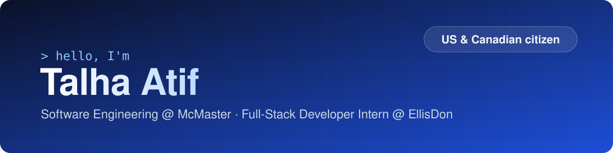

  

  
  
  
  

## 🛠️ Tech stack

<table>
  <tr>
    <td><b>Languages</b></td>
    <td><picture><source media="(prefers-color-scheme: dark)" srcset="https://skillicons.dev/icons?i=py%2Cts%2Cjs%2Cjava%2Cgo%2Ccs%2Cbash%2Chtml%2Ccss&theme=dark" /></picture></td>
  </tr>
  <tr>
    <td><b>Frameworks</b></td>
    <td><picture><source media="(prefers-color-scheme: dark)" srcset="https://skillicons.dev/icons?i=react%2Cnodejs%2Cdotnet%2Cspring%2Cfastapi%2Ctailwind&theme=dark" /></picture></td>
  </tr>
  <tr>
    <td><b>Tools</b></td>
    <td><picture><source media="(prefers-color-scheme: dark)" srcset="https://skillicons.dev/icons?i=postgres%2Cdocker%2Cgithubactions%2Cgit%2Clinux%2Cmongodb%2Csupabase%2Cmaven&theme=dark" /></picture></td>
  </tr>
</table>

## 🚀 Recently built

### [Compete](https://talhaatif.com/compete/#/demo)

`React` `TypeScript` `PostgreSQL` `Supabase` `Node.js` `GitHub Actions`

- ⚡ Cut dashboard query latency by over 90% on a 100k-row benchmark by replacing per-row RLS checks with a set-based membership lookup
- 🔒 Enforced multi-tenant isolation across 10 Postgres tables, verified by 320+ SQL tests
